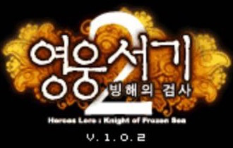
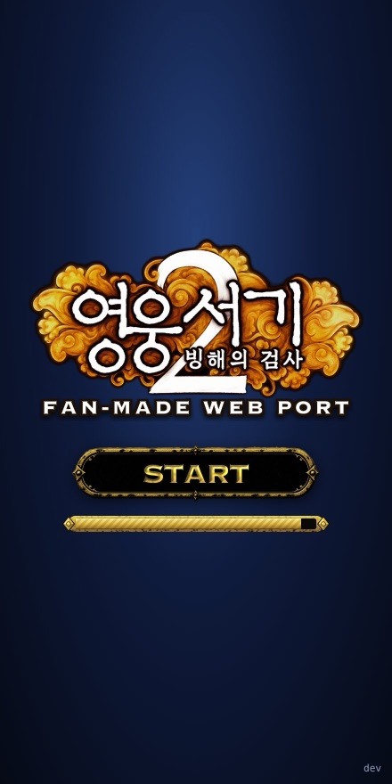
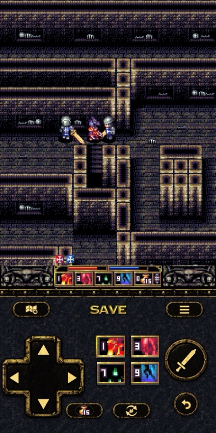
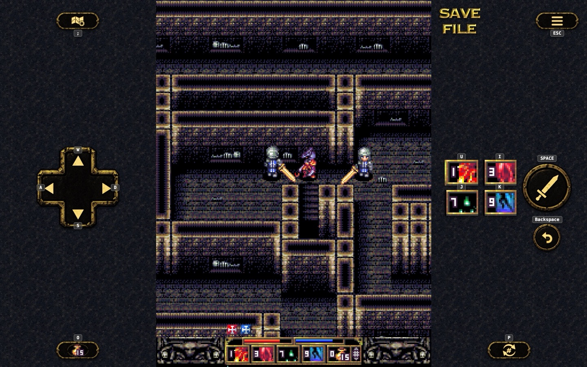
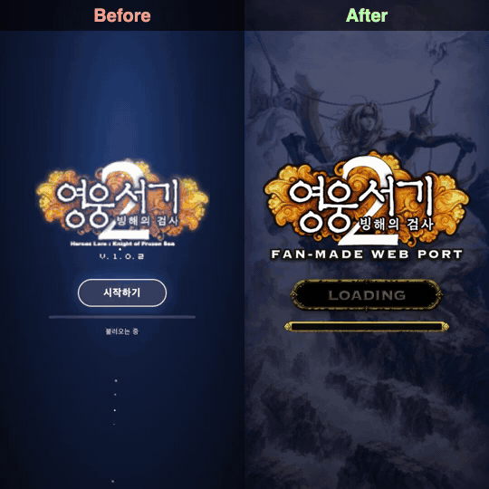
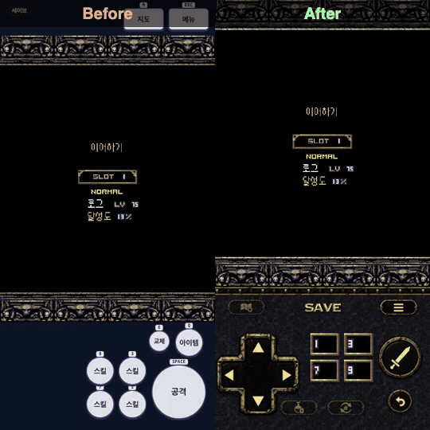
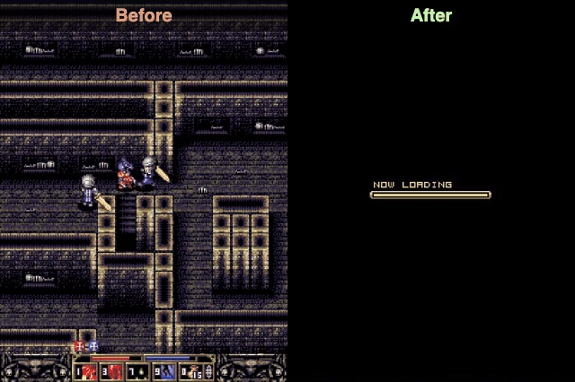
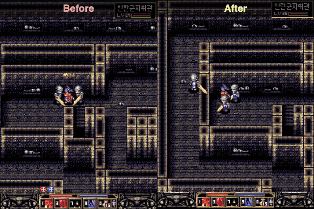
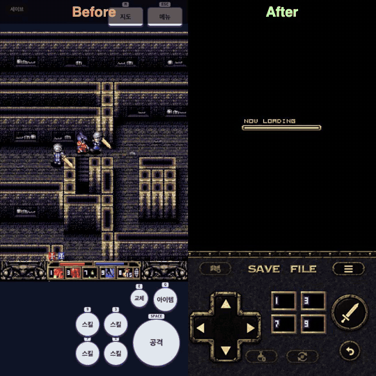

<div align="center">

[English](README.md) · **한국어**

<br />



### 영웅서기 2: 빙해의 검사, 브라우저에서

**2007년 피처폰 RPG를 WebAssembly 에뮬레이터로, 폰과 PC 브라우저에서 바로.**

[](#notice)
[](#notice)
[](#notice)
[](#how-it-works)
[](https://github.com/dlunch/wie)
[](LICENSE)

[개선한 것](#이-포팅에서-개선한-것) · [비포 / 애프터](#비포--애프터) · [동작 방식](#동작-방식) · [조작](#조작) · [세이브](#세이브) · [빌드](#빌드)

</div>

<a id="notice"></a>

> [!IMPORTANT]
> **팬메이드 · 광고 없음 · 수익 없음.** 이 저장소는 개인이 만든 비공식 팬 프로젝트입니다. 광고를 붙이지 않고,
> 어떤 형태로도 돈을 받지 않습니다. 게임의 권리는 원 개발사와 현 권리자에게 있습니다.
> **권리자의 요청이 있거나 문제가 생기면 즉시 삭제합니다.**

> [!NOTE]
> **1편도 브라우저에서:** [영웅서기: 솔티아의 바람 리마스터 웹판 (hero-lord-web)](https://github.com/LESANF/hero-lord-web) · [바로 플레이](https://lesanf.github.io/hero-lord-web/)

<div align="center">

<table>
<tr>
<td align="center"><br /><sub>시작 화면</sub></td>
<td align="center"><br /><sub>폰 (세로)</sub></td>
</tr>
</table>

<br />
<sub>PC / 가로 화면: 게임 옆에 조작부</sub>

</div>

---

## 이 포팅에서 개선한 것

2007년 버전은 240×320 키패드 폰용입니다. 그대로 브라우저에서 돌리면 돌아가긴 하지만, 부팅이 느리고 소리가 안 나고
10fps로 움직이며 폰으로 잡고 할 방법이 없습니다. 아래가 바꾼 것들이고, 하나하나 작게 고치고 문서로 남겼습니다.

| | 전 | 후 | 위치 |
|---|---|---|---|
| 사운드 | 무음 (에뮬레이터의 MMF 재생 클래스가 빈 껍데기) | 음악·효과음 | `engine/patches/skt-audio-clip.patch` |
| 이어하기 로딩 | 5.3초 | 0.6초 | `engine/patches/fs-cache.patch` |
| 타이틀까지 부팅 | 4.9초, 퍼블리셔 스플래시 + PRESS ANY KEY | 2.4초, 시작 화면 뒤에서 부팅하고 인트로 생략 | `tools/patch_game.py`, `hero.ts` |
| 게임 속도 | 보통 = 10fps | 보통 = 15fps (옵션의 4단계는 그대로) | `docs/05-game-patches.md` |
| 화면 흔들림 | 보스 타격·스킬마다 4~5px | 1/4 | `docs/05-game-patches.md` |
| 타이틀 메뉴 | 9항목, 동작하지 않는 WAP·선물하기·게임종료 포함 | 6항목, 네트워크 메뉴는 준비중 팝업, 등급 배지·퍼블리셔 로고 제거 | `docs/05-game-patches.md` |
| 조작 | 폰 키패드 0~9 # * | 게임보이식 패드: 십자키, 게임 안 스킬 슬롯 그림을 그대로 보여주는 스킬 키, 아이템·교체·뒤로가기, PC는 키보드 | `engine/overlay/` |
| 화면 | 240×320 고정 | 세로 폰은 화면을 꽉 채움, PC·가로 화면은 게임 옆에 조작부 | `hero.ts` `layout()` |
| 저장 | 메뉴 → 시스템 → 세이브 → 예, 키 다섯 번 | 패드의 **SAVE** 한 번으로 게임 저장 | `hero.ts` |
| 세이브 파일 | 한 브라우저에 갇힘 | SAVE 아래 **FILE**로 JSON 파일 하나 내보내기/가져오기 | `saves.ts` |

### 비포 / 애프터

같은 브라우저, 같은 세이브입니다. 전 = 처음 돌아가던 빌드(이번 변경 전의 `main`, 패치 안 한 게임),
후 = 지금 브랜치.

| 부팅: 페이지 열기 → 타이틀 | 이어하기: 세이브 불러오기 |
|---|---|
|  |  |
| 왼쪽은 스플래시와 PRESS ANY KEY, 오른쪽은 시작 화면 뒤에서 이미 부팅 | 예전 엔진은 파일을 읽을 때마다 한 프레임씩 기다렸음 |

| 속도: 걷기, 보통 | 흔들림: 스킬 4개 사용 |
|---|---|
|  |  |
| 10 → 15fps | 예전 진폭의 1/4 |

**조작과 화면**



영상에는 소리가 없습니다. 예전엔 무음이었고 지금은 음악과 효과음이 납니다.

게임 클래스 수정은 빌드 때 패키지에 적용하는 같은 길이의 바이트 패치입니다(`tools/patch_game.py`, 패턴이 정확히
한 번 나오지 않으면 빌드 실패). 엔진 수정은 고정된 wie 커밋 위에 얹는 작은 패치입니다. 게임 자체를 새로 그리거나
다시 짠 부분은 없습니다.

## 동작 방식

게임은 한국 피처폰용 Java ME 앱입니다. 이 폰들을 위한 오픈소스 에뮬레이터 [wie](https://github.com/dlunch/wie)(MIT)를
WebAssembly로 빌드해 돌리고, 이 저장소는 그 바깥의 페이지를 더합니다.

```
게임 패키지 ─▶ tools/patch_game.py ─▶ hero2.zip ─┐
wie 코어 (Rust → wasm, 고정 커밋) + engine/patches/ ─▶ wasm ─┼─▶ 정적 사이트
engine/overlay/ (페이지, 패드, 레이아웃, 세이브) ──────────────┘
```

| 단계 | 파일 | 설명 |
|---|---|---|
| 분석 | `docs/01-analysis.md` | 패키지 구성, 게임이 읽는 키 |
| 패키지 | `tools/clean_package.py`, `tools/patch_game.py` | 앱 파일만 남기고 바이트 패치 적용 |
| 코어 | `engine/build.sh`, `engine/WIE_COMMIT`, `engine/patches/` | wie를 한 커밋으로 받아 패치 후 `wasm-pack` + webpack |
| 페이지 | `engine/overlay/src/{html,ts,css}` | `hero.ts` 부팅·레이아웃, `input.ts` 패드, `saves.ts` 내보내기/가져오기 |
| 배포 | `.github/workflows/pages.yml` | 릴리스 `skt-pkg`에서 패키지를 받아 빌드 후 `build/web` 배포 |

싱글 스레드 wasm이라 COOP/COEP 헤더가 필요 없고 아무 정적 호스팅에서나 돌아갑니다.

## 조작

| 동작 | 패드 | 키보드 |
|---|---|---|
| 이동 | 십자키 | W A S D, 방향키 |
| 공격 / 확인 | 검 버튼 | Space, Enter, L |
| 스킬 1 · 3 · 7 · 9 | 스킬 키 4개 | U I / J K |
| 아이템 | 물약 버튼 | O |
| 교체 / 대화 넘기기 | 교체 버튼 (대화 중엔 스킵) | P |
| 지도 | 지도 버튼 | ; |
| 메뉴 / 뒤로 | 메뉴 버튼, 뒤로가기 버튼 | Esc, Backspace |

화면별 전체 조작: `docs/03-controls.md`. 키 표시는 키보드가 있을 때만 패드 위에 뜹니다.

## 세이브

패드의 **SAVE**는 한 번에 게임 저장을 합니다(메뉴 → 시스템 → 세이브 → 예를 대신 눌러 줌, 필드에서만). 게임은 브라우저(사이트별 IndexedDB)에 저장하고, SAVE 아래 **FILE**을 누르면 세이브 내보내기(저장된 항목 전부를 JSON
파일 하나로)와 세이브 가져오기(그 파일을 다시 쓰고 새로고침)가 나옵니다. 기기나 브라우저를 옮길 때 쓰세요.

## 빌드

```
GAME=path/to/hero2.zip sh engine/build.sh      # node 20+, rust stable, wasm32 타깃, wasm-pack
cd build/web && python3 -m http.server 8791
```

폰에서 소리를 들으려면 보안 컨텍스트(https 또는 localhost)가 필요합니다. 진행 상황과 결정 사항은 `docs/00-handoff.md`.

## 크레딧

- 게임: 핸즈온 모바일 코리아 / 엠포마 코리아 (현 권리자 EA). 요청 시 내립니다.
- 에뮬레이터 코어: [wie](https://github.com/dlunch/wie), dlunch, MIT.
- 참고: [Heroes Lore 2 Recomp](https://github.com/davidkalil10/Heroes-Lore-2-The-Knight-of-Frozen_Sea-Recomp).
